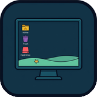

<p align="center">
  
</p>

# Seabed

[](https://github.com/studio2201/seabed/actions/workflows/ci.yml)
[](https://github.com/studio2201/seabed/releases/latest)
[](LICENSE)
[](https://ubermetroid.github.io/tuition-not-coffee)
[](https://github.com/studio2201/seabed)

**Seabed** (`seabed@studio2201.github.io`) is a fast, zero-subprocess, Wayland-native **Desktop Icons** extension for **GNOME Shell 45–50**. It renders your `~/Desktop` files, folders, `.desktop` application launchers, Personal Home folder, Trash (`trash:///`), and mounted external/network drives directly inside `Main.layoutManager._backgroundGroup`—with **zero fake `Meta.Window` objects**, **zero external GTK3 subprocesses**, **bidirectional native drag-and-drop** (grid repositioning with live target-slot highlight preview, dropping onto folders/Trash/drives, dragging from the desktop into open File Manager windows, and dragging from File Manager windows onto the desktop), **live image & thumbnail previews**, Kelp/Reef accent selection borders, native right-click context menus, and a **4-tab Libadwaita Settings & About dialog**.

Derived from [Desktop Icons NG (DING)](https://gitlab.com/rastersoft/desktop-icons-ng) (`ding@rastersoft.com`) — stripped of the external GTK3 `ding.js` subprocess and X11 window-title coordinate emulation hacks (`emulateX11WindowType.js`), and engineered under the same strict [`AGENTS.md`](AGENTS.md) Page Rule and EGO standards as [**Kelp**](https://github.com/studio2201/kelp), [**Reef**](https://github.com/studio2201/reef), and [**Shoal**](https://github.com/studio2201/shoal). Official project artwork is archived in [`brand/`](brand/) (`icon-512.png`, `icon-256.png`, `icon-160.png`, `favicon-64.png`).

> 🎓 **Support Seabed — [Tuition, Not Coffee — Help send my daughter to college](https://ubermetroid.github.io/tuition-not-coffee)** · 🌐 [**Project Website (`studio2201.github.io/seabed`)**](https://studio2201.github.io/seabed/) · ⭐ [**Star studio2201/seabed on GitHub**](https://github.com/studio2201/seabed)

---

## Why Seabed Replaces DING for Wayland + Kelp + Reef + Shoal

| Feature | Default | Why It Matters |
| :--- | :--- | :--- |
| **Native `_backgroundGroup` Rendering** | **Active** | Renders desktop icons directly on the compositor wallpaper layer below all windows—no fake `Meta.Window` objects that confuse window tilers (**Kelp**) or trigger false window-dodge in docks (**Reef**). |
| **Bidirectional Drag-and-Drop & Slot Preview** | **Active** | Drag icons to any desktop grid slot (`icon-positions`) with a live drop-target cell highlight preview, drop files onto desktop folders/Home/Volumes/Trash, drag from the desktop into an open Files/Nautilus window, or drag from Files/Nautilus directly onto the desktop or a desktop folder. |
| **Live Image & Thumbnail Previews** | **Active** | Renders freedesktop thumbnails (`thumbnail::path`) and direct `Gio.FileIcon` previews for desktop images alongside `.desktop` app launcher icons and symlink badges. |
| **Zero Subprocesses (`shexli` Clean)** | **Active** | Monitors `~/Desktop`, `trash:///`, and `Gio.VolumeMonitor` mounts via pure asynchronous GIO (`enumerate_children_async` + `Gio.FileMonitor`) with `0 shexli findings`. |
| **4-Corner Grid & 5 Sort Modes** | **Top-Left / Name** | Arrange icons from `top-left`, `top-right`, `bottom-left`, or `bottom-right` sorted by `NAME`, `DESCENDINGNAME`, `MODIFIEDTIME`, `KIND`, or `SIZE` with pinned or mixed special folders. |
| **Native GNOME Shell Context Menus** | **Built-in** | Right-click any desktop icon or the desktop wallpaper to `Open`, `Open in Files`, `Open in Terminal`, `Move to Trash`, `Empty Trash`, `Unmount`, `New Folder on Desktop`, `Sort Desktop By`, `Arrange All Icons to Grid`, or open **Seabed Settings & About…**. |
| **Unified Kelp & Reef Accent Borders** | **Coral Red (`2px`)** | Selected and hovered desktop tiles display a crisp accent border ring with 1-click presets (*Gruvbox Amber*, *Kelp Emerald*, *Ocean Cyan*, *Coral Red*). |

---

## Quick Install

Download `seabed@studio2201.github.io.shell-extension.zip` from [**GitHub Releases (`v1.5.0`)**](https://github.com/studio2201/seabed/releases/latest):

```bash
gnome-extensions install --force seabed@studio2201.github.io.shell-extension.zip
gnome-extensions enable seabed@studio2201.github.io
```

Open the 4-tab Libadwaita Preferences window anytime by right-clicking the desktop or any desktop icon and choosing **Seabed Settings & About…**, or by running:

```bash
gnome-extensions prefs seabed@studio2201.github.io
```

---

## 4-Tab Libadwaita Settings & About Window

| Tab | Controls Included |
| :--- | :--- |
| **1. Desktop & Icons** | Show Personal Home Folder, Show Trash Icon (`trash:///`), Show Mounted External Drives, Show Network Drives, Show Hidden Files (`.dotfiles`), Show Symlink Emblem Badge, Single-Click to Open, Show on All Monitors, and **Reset to Seabed Defaults**. |
| **2. Grid & Sorting** | Icon Size (`Tiny 32px`, `Small 36px`, `Standard 48px`, `Large 64px`), Start Corner (`Top Left`, `Top Right`, `Bottom Left`, `Bottom Right`), Arrange Order (`Name A -> Z`, `Name Z -> A`, `Modified Time`, `Kind / Type`, `File Size`), and Sort Special Folders Alongside Files toggle. |
| **3. Appearance & Borders** | Dark Text in Icon Labels (for light wallpapers), Show Selection & Hover Border Ring, Accent Border Color picker, **Quick Color Presets** (*Gruvbox Amber*, *Kelp Emerald*, *Ocean Cyan*, *Coral Red*), **Sync Color Across Suite** (`Sync Suite Color` across all installed Studio 2201 extensions), Border Width (`0–8 px`), and Border Corner Radius (`0–24 px`). |
| **4. About & Support** | Release version (`v1.5.0`), `GPL-3.0-or-later` license & Desktop Icons NG attribution, **Star Seabed on GitHub**, **Tuition, Not Coffee — Help send my daughter to college**, **Project Website**, and **Report an Issue**. |

---

## Multi-Distro & `systemd` Integration

Seabed works out of the box across **GNOME Shell 45, 46, 47, 48, 49, and 50** on **Fedora, Debian, Ubuntu, Arch Linux, openSUSE, and NixOS**:

- **`systemd-logind` Lock & Suspend Lifecycle**: Declares `"session-modes": ["user"]` so screen lock (`unlock-dialog`) cleanly destroys all background actors, cancels in-flight `Gio.Cancellable` enumerations, disconnects `Gio.FileMonitor` and `Gio.VolumeMonitor` signals, and unloads the stylesheet on `disable()`.
- **Cross-Distro Desktop & File Manager Support**: Resolves localized `~/Desktop` paths via `GLib.get_user_special_dir(GLib.UserDirectory.DIRECTORY_DESKTOP)` and opens files, folders, `trash:///`, and mounted volumes with the default file manager (Nautilus/Files, Dolphin, Thunar, Nemo) or launches `.desktop` shortcuts via `GioUnix.DesktopAppInfo`.

---

## Verification & Development

Seabed enforces strict architectural invariants (`16..=256` lines per `.js` file, `<= 200` chars per line, `<= 8` visible entries per directory, zero banned filenames, and strict process-boundary separation between `prefs.js` and compositor modules) verified by `tests/verify.js`:

```bash
xmllint --noout extension/schemas/*.xml
glib-compile-schemas --strict --dry-run extension/schemas
gjs -m tests/verify.js
gnome-extensions pack extension --force --out-dir=dist \
  --schema=schemas/org.gnome.shell.extensions.seabed.gschema.xml \
  --extra-source=desktop --extra-source=ui
pipx run shexli dist/seabed@studio2201.github.io.shell-extension.zip
```

---

## 🎓 Sponsor / Support — Tuition, Not Coffee

If Seabed, Shoal, Reef, and Kelp improve your daily Linux workflow, please consider supporting development:

- 🎓 **Sponsor / Donate**: [**Tuition, Not Coffee — Help send my daughter to college**](https://ubermetroid.github.io/tuition-not-coffee)
- 🌐 **Project Website**: [**studio2201.github.io/seabed**](https://studio2201.github.io/seabed/)
- ⭐ **Star on GitHub**: [**github.com/studio2201/seabed**](https://github.com/studio2201/seabed)

---

## License & Attribution

Released under the [GNU General Public License v3.0 or later](LICENSE) (`GPL-3.0-or-later`).

Derived from [Desktop Icons NG (DING)](https://gitlab.com/rastersoft/desktop-icons-ng) (`GPL-3.0-or-later`), Copyright (C) Sergio Costas `<rastersoft@gmail.com>`, Carlos Soriano `<csoriano@redhat.com>`, and contributors.
